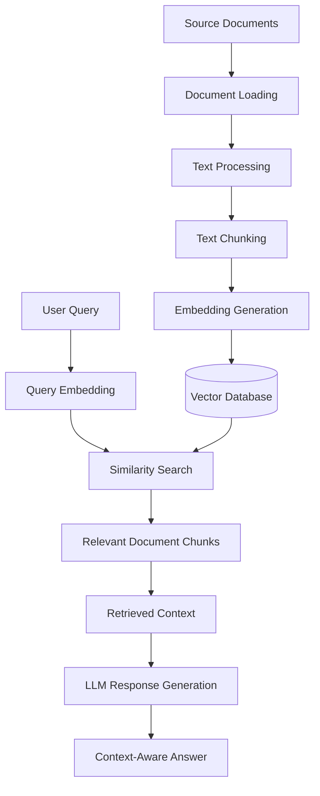

# Simple RAG System

A Python-based Retrieval-Augmented Generation (RAG) system demonstrating how to build an AI application that retrieves relevant information from a knowledge base using document ingestion, embeddings, and vector database search.

The project implements the core components of a RAG architecture, including document processing, embedding generation, vector storage, and semantic retrieval.

**GitHub Repository:** [Simple RAG System](https://github.com/marufkhan20/simple-rag-system)

---

## Overview

Large Language Models (LLMs) can generate incorrect or unsupported information when they don't have access to relevant context.

Retrieval-Augmented Generation (RAG) addresses this limitation by retrieving relevant information from an external knowledge base and providing that information as context to the language model.

This project demonstrates the fundamental RAG workflow using Python.

Instead of relying entirely on an LLM's pretrained knowledge, the system retrieves relevant information from ingested documents to support more context-aware responses.

## Architecture

The system follows a modular RAG architecture with two primary pipelines:

1. **Document Ingestion Pipeline:** Processes source documents, prepares text, generates embeddings, and stores them in a vector database.
2. **Retrieval Pipeline:** Accepts user queries, retrieves semantically relevant document chunks, and provides the retrieved context for downstream response generation.

### RAG Workflow



## Core Components

### 1. Document Ingestion Pipeline

The ingestion pipeline prepares documents for semantic retrieval.

Key responsibilities:

- Load source documents.
- Extract and process document content.
- Split documents into smaller chunks.
- Generate vector embeddings.
- Store embeddings and associated document information in a vector database.

This makes the document collection searchable through semantic similarity rather than relying only on exact keyword matching.

### 2. Embedding Generation

The system converts text into numerical vector representations using an embedding model.

These embeddings capture semantic relationships between text passages, allowing the retrieval system to identify relevant content even when the user's wording differs from the original document.

### 3. Vector Database

The vector database stores document embeddings and associated information.

It enables similarity-based searches to retrieve document chunks that are semantically related to a user's query.

### 4. Retrieval Pipeline

The retrieval pipeline is responsible for finding relevant information from the indexed knowledge base.

The process includes:

- Accepting a user query.
- Generating a query embedding.
- Performing vector similarity search.
- Retrieving relevant document chunks.
- Returning the retrieved context for downstream processing.

### 5. Context-Aware Response Generation

Retrieved document chunks can be passed to an LLM as context to generate answers grounded in the available information.

A production implementation can extend this component with source citations, confidence thresholds, and fallback responses when relevant information cannot be retrieved.

---

## Technology Stack

| Component | Technology |
|---|---|
| Programming Language | Python |
| Document Processing | Document ingestion pipeline |
| Embeddings | Embedding models |
| Vector Storage | Vector database |
| Retrieval | Semantic similarity search |
| AI Integration | LLM integration |

*See the project dependencies and source code for the exact libraries and model providers used.*

## Project Structure

The project separates document ingestion and retrieval into independent pipeline components.

```text
simple-rag-system/
│
├── ingestion_pipeline.py
├── retrieval_pipeline.py
├── requirements.txt
├── README.md
└── ...
```

*The structure above highlights the main pipeline files. Refer to the repository for the complete project structure.*

## Getting Started

### Prerequisites

- Python 3.10+
- pip
- API credentials for any external embedding or LLM provider used by the project.

### 1. Clone the Repository

```bash
git clone https://github.com/marufkhan20/simple-rag-system.git

cd simple-rag-system
```

### 2. Create a Virtual Environment

```bash
python -m venv venv
```

Activate it:

**macOS / Linux**

```bash
source venv/bin/activate
```

**Windows**

```bash
venv\Scripts\activate
```

### 3. Install Dependencies

```bash
pip install -r requirements.txt
```

### 4. Configure Environment Variables

Create a `.env` file in the project root and add the credentials required by your configured providers.

```env
OPENAI_API_KEY=your_api_key
```

Adjust the variables according to the actual configuration used in the project.

### 5. Run the Pipelines

Run the ingestion and retrieval scripts according to their configured entry points:

```bash
python ingestion_pipeline.py
```

```bash
python retrieval_pipeline.py
```

---

## Potential Applications

The architecture demonstrated in this project can be extended to build:

- AI-powered customer support chatbots.
- Internal company knowledge assistants.
- Document question-answering systems.
- Healthcare and employee benefits information assistants.
- Enterprise knowledge management systems.
- Customer-specific AI assistants.

## Future Improvements

Potential extensions for a more production-oriented RAG system include:

- Metadata-based filtering and document-level access control.
- Multi-tenant knowledge bases.
- Hybrid search combining semantic and keyword retrieval.
- Reranking for improved retrieval relevance.
- Source citations and document references.
- Retrieval evaluation and automated testing.
- Hallucination detection and fallback handling.
- Monitoring and retrieval performance analytics.

## Author

**Rashedul Islam**

Full-Stack Developer | AI Application Developer

- GitHub: [@marufkhan20](https://github.com/marufkhan20)

---

*This project is intended as a demonstration of the core concepts and implementation of a Retrieval-Augmented Generation system using Python.*
